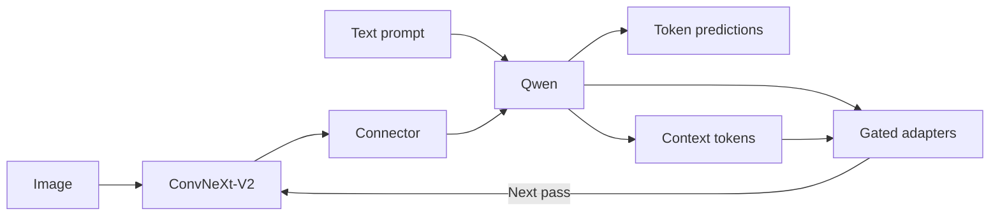

# neural-VLM

I'm using this project to test whether language feedback can change a visual model's
representations across repeated passes through an image. The model combines a
ConvNeXt-V2 encoder with a Qwen language model. Hidden states from the language model
feed back into the visual encoder through gated adapters.

The implementation is running on synthetic examples. I haven't established a
benchmark gain or a neural-alignment result yet.

## What I'm building

My main addition is the recurrent connection between the visual and language models.
The adapters act on intermediate visual stages, and a small bank of context tokens
carries state between iterations. I initialize each adapter gate at zero but leave
its output projection nonzero. This makes the initial output match the single-pass
model while allowing the gate to receive a gradient. The [construction check](scripts/build_main.py)
compares the two outputs, and the [short training check](scripts/test_training.py)
checks that the gates move away from zero.

The control settings vary recurrence, the source of feedback, and memory. They are
intended to answer a separate question: if repeated passes help, which part of the
loop is responsible? The compute-matched and no-language controls still need work;
the [implementation notes](docs/RESEARCH_STATUS.md) describe the gaps.



Start with [the recurrent model](model/recurrent_vlm.py),
[adapters](model/top_down_adapter.py), and [control configs](configs/controls.yaml).
The training code supports separate learning rates for the feedback parameters,
LoRA, and checkpoints containing only trainable parameters.

## Try it on a CPU

Use Python 3.11 or 3.12 on Linux or macOS. This runs a small, randomly initialized
model with synthetic images and text; no GPU or model download is needed.

```bash
git clone https://github.com/rbybryan/neural-VLM.git
cd neural-VLM
python3 -m venv .venv
source .venv/bin/activate
python -m pip install -r requirements-smoke.txt
python scripts/run_cpu_smoke.py
```

The seven checks cover model construction, data loading, ten training steps,
evaluation, control variants, probes, and dataset converters. They check that the
pieces work together; the printed scores are from synthetic data.

For a shorter first run:

```bash
python scripts/build_main.py --smoke
```

`verify_real_assembly.py` is a separate check that downloads real weights.

## Experiments

The evaluation code includes Winoground and SugarCrepe-style comparisons, iteration
sweeps, and probes of visual modulation and context-token content. I also have
analysis modules for neural representations and reaction times. These still need
validation with real data; the [current status](docs/RESEARCH_STATUS.md) lists the
next steps.

The [design notes](SPEC_v1.md) and [hypotheses](PREREGISTRATION.md) record the intended
comparisons. The hypotheses have an in-repository tag; no external registration is
linked. H3 now uses THINGS-EEG2 following this
[amendment](docs/preregistration_amendment_01.md).

For GPU work, use `bash scripts/setup_env.sh` on Linux with Conda and CUDA 12.1,
then follow the [training guide](docs/USAGE.md) and [data setup](docs/dataset_access.md).
Set `NEURAL_VLM_DATA_ROOT` to your dataset directory. The CPU requirements are separate
from that training environment.

## Built on

This project uses ConvNeXt-V2, Qwen2.5, PEFT/LoRA, and Accelerate. My work is the
recurrent integration and the experiments around it. Original code here is
[MIT licensed](LICENSE); external code, weights, and datasets retain their own terms.
For reuse, cite the relevant methods and datasets, and include the commit used from
this repo.
