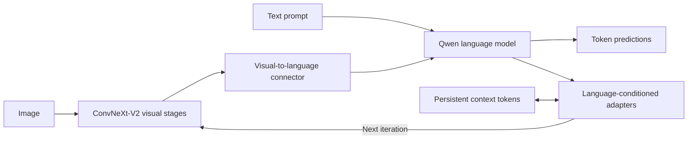

# neural-VLM: language-conditioned recurrent vision

An experimental vision–language model that feeds language-model hidden states back into
a visual encoder across multiple iterations. The research question is whether this
feedback improves compositional visual reasoning and provides useful predictions for
neural and behavioral measurements.

**Status: research prototype.** Model, training, evaluation, and probe code are implemented.
Synthetic CPU checks exercise the implementation. This repository does **not** report
completed confirmatory training, benchmark improvements, or established brain alignment.

[Run the CPU checks](#quick-start-no-model-downloads) · [Architecture](#architecture) ·
[Research status](docs/RESEARCH_STATUS.md) · [Training](docs/USAGE.md) · [Data setup](docs/dataset_access.md)

## What is implemented

- **Language-conditioned feedback:** cross-attention adapters with zero-initialized output
  gates inject language context into intermediate ConvNeXt-V2 stages.
- **Recurrent computation:** repeated visual/linguistic processing with persistent context
  tokens and explicit control variants for recurrence, memory, and language feedback.
- **Training support:** parameter-group learning rates, LoRA integration, Accelerate,
  selective checkpoints, and gradient/gate diagnostics.
- **Evaluation:** Winoground and binary-discrimination interfaces, iteration sweeps,
  mechanism probes, and neural/behavioral analysis modules.

This repository's contribution is the recurrent integration and its experimental tools.
ConvNeXt-V2, Qwen2.5, LoRA/PEFT, and the datasets are external work; their models and data
are obtained separately and retain their original attribution and terms.

## Architecture



At initialization, zero-valued adapter gates should make the recurrent path agree with
its single-pass control. The synthetic checks test that property and check that gates
receive gradients. These are implementation checks, not evidence that recurrence improves
a trained model.

## Quick start: no model downloads

Use Python 3.11 or 3.12 on Linux or macOS. The small model uses random weights and
synthetic images/text. No GPU, API key, benchmark access, or pretrained weights are needed.

```bash
git clone https://github.com/rbybryan/neural-VLM.git
cd neural-VLM
python3 -m venv .venv
source .venv/bin/activate
python -m pip install -r requirements-smoke.txt
python scripts/run_cpu_smoke.py
```

The runner executes seven checks and stops on any failure. It sets CPU/offline modes,
uses temporary synthetic data, and prints a final success summary. Depending on the
machine, allow several minutes after dependency installation.

| Check | What it exercises |
|---|---|
| `build_main.py --smoke` | Forward/backward pass and zero-init single-pass equivalence |
| `test_data_pipeline.py` | Synthetic conversations, batching, and decontamination |
| `test_training.py` | Ten optimizer steps, gate updates, and checkpoint creation |
| `test_eval.py` | Scoring and benchmark interfaces on synthetic examples |
| `test_specificity_suite.py` | Control variants and iteration metrics |
| `test_probes.py` | Mechanism-probe null behavior at initialization |
| `test_loaders.py` | Dataset-shaped rows converted into evaluation manifests |

For a shorter first check, run `python scripts/build_main.py --smoke`.
`verify_real_assembly.py` is separate: it downloads real weights and is not part of the
offline suite. Do not run it expecting the same resource requirements.

## Research protocol and evidence

The [research specification](SPEC_v1.md), [in-repository hypothesis plan](PREREGISTRATION.md),
and [dated amendment](docs/preregistration_amendment_01.md) describe intended experiments.
They are plans, not completed results or evidence of external preregistration.
The H3 implementation follows the amendment from THINGS-MEG to THINGS-EEG2.

See [research status and limitations](docs/RESEARCH_STATUS.md) for what remains untested.
No sample output from the synthetic suite should be described as benchmark accuracy.

## Real training and evaluation

The historical GPU setup is `bash scripts/setup_env.sh` (Linux, Conda, CUDA 12.1).
It is distinct from the CPU smoke environment. `requirements.lock.txt` is a historical
machine snapshot, not the portable CPU recipe.

Follow [training and evaluation](docs/USAGE.md) and [dataset setup](docs/dataset_access.md).
Set `NEURAL_VLM_DATA_ROOT` or individual dataset variables for your machine; no lab-specific
mount is required. The [SLURM template](scripts/slurm_train_tier1.sh) takes data, environment,
and cluster options explicitly.

## Repository guide

| Path | Purpose |
|---|---|
| `model/` | Visual encoder, language wrapper, connector, adapters, memory, recurrence |
| `data/` | Conversation schema, transforms, collator, perceptual-hash filtering |
| `training/` | Training loop, scheduling, checkpoint utilities |
| `evaluation/` | Benchmark interfaces, controls, probes, dataset converters |
| `analysis/` | Neural/behavioral analyses and configurable data paths |
| `configs/` | Development, default, larger-model, and control configurations |
| `scripts/` | Construction, training, preparation, and runnable smoke checks |

## License and attribution

Original code in this repository is available under the [MIT license](LICENSE).
External libraries, model weights, and datasets retain their own licenses and access
conditions. Obtain restricted datasets directly from their providers; do not commit
credentials, subject data, or downloaded weights.

For reuse, cite this repository and the exact commit, and cite the original methods and
datasets described in the research specification. No publication or DOI is claimed here.

[Release-preparation scope and publication notes](docs/RELEASE_PREPARATION.md).
